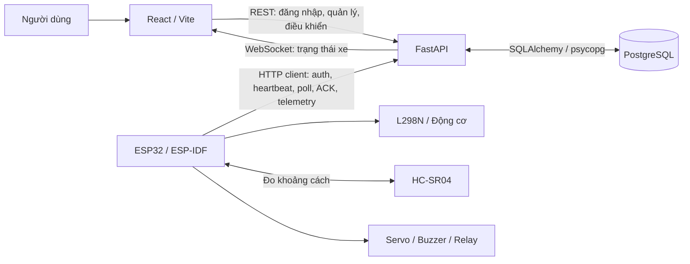

# SmartRobot

SmartRobot là hệ thống quản lý và điều khiển xe robot ESP32 qua web. Người dùng có thể xem trạng thái xe, nhận quyền điều khiển, lái bằng bàn phím hoặc D-Pad và chuyển sang chế độ tự tránh vật cản. Quản trị viên quản lý tài khoản, xe và thông tin xác thực của từng thiết bị.

Hệ thống gồm frontend React, backend FastAPI, PostgreSQL và firmware ESP-IDF. ESP32 kết nối Wi-Fi và chủ động trao đổi với backend qua HTTP(S); trình duyệt nhận trạng thái qua REST và WebSocket. Mỗi xe có thông tin xác thực riêng, hỗ trợ nhiều xe cùng hoạt động.

## Mục lục

- [Chức năng](#chức-năng)
- [Kiến trúc dự án](#kiến-trúc-dự-án)
- [Nguyên lý hoạt động](#nguyên-lý-hoạt-động)
- [Phần cứng và sơ đồ chân](#phần-cứng-và-sơ-đồ-chân)
- [Setup và chạy web](#setup-và-chạy-web)
- [Setup, build và nạp firmware](#setup-build-và-nạp-firmware)
- [Chạy toàn bộ hệ thống](#chạy-toàn-bộ-hệ-thống)
- [Kiểm thử và kiểm tra bản build](#kiểm-thử-và-kiểm-tra-bản-build)
- [Xử lý lỗi thường gặp](#xử-lý-lỗi-thường-gặp)
- [Tài liệu chi tiết](#tài-liệu-chi-tiết)

## Chức năng

| Đối tượng | Chức năng |
| --- | --- |
| Người dùng | Đăng nhập, xem danh sách và chi tiết xe, tìm/lọc xe Online–Offline–Busy |
| Người điều khiển | Nhận/Trả xe, điều khiển Tiến/Lùi/Trái/Phải, chọn Manual/Auto, theo dõi cảm biến và xác nhận lệnh |
| Quản trị viên | Tạo/sửa tài khoản, đổi quyền, kích hoạt/vô hiệu hóa, đặt lại mật khẩu; quản lý xe và xoay credential |
| ESP32 | Xác thực, heartbeat, lấy lệnh, gửi ACK và telemetry, điều khiển motor/servo/còi/relay, giám sát điều kiện dừng cục bộ |

Không có tài khoản mặc định hay đăng ký công khai. Admin đầu tiên được tạo bằng CLI; các tài khoản tiếp theo được tạo trên trang quản trị.

## Kiến trúc dự án



Backend lưu quyền điều khiển, lệnh và trạng thái thiết bị trong PostgreSQL. ESP32 chủ động poll lệnh nên backend không cần biết IP của xe và xe không cần chạy web server. WebSocket phục vụ cập nhật giao diện; đường truyền lệnh tới xe đi qua Device API.

| Thành phần | Công nghệ và trách nhiệm |
| --- | --- |
| Frontend | React 19, TypeScript, Vite, Tailwind CSS, TanStack Query, React Router; giao diện, phiên đăng nhập, REST và WebSocket |
| Backend | Python 3.12+, FastAPI, SQLAlchemy, Alembic; phân quyền, quản lý xe, điều phối lệnh và Device API |
| Database | PostgreSQL 18; người dùng, phiên đăng nhập, xe, lượt mượn, lệnh, telemetry và audit log |
| Firmware | C, ESP-IDF qua PlatformIO; tác vụ FreeRTOS cho giao tiếp, cảm biến, điều khiển và watchdog |

```text
SmartRobot/
├── README.md                 # Hướng dẫn chung
├── .env.example              # Mẫu cấu hình backend và PostgreSQL
├── .env.test.example         # Mẫu cấu hình database kiểm thử
├── compose.yaml              # PostgreSQL cho môi trường local
├── backend/
│   ├── app/api/              # REST endpoints và dependencies xác thực
│   ├── app/core/             # Settings, bảo mật, xử lý lỗi
│   ├── app/models/           # Models SQLAlchemy
│   ├── app/schemas/          # Request/response schemas
│   ├── app/services/         # Nghiệp vụ, điều khiển và Device API
│   ├── app/repositories/     # Truy cập dữ liệu
│   ├── app/websocket/        # Luồng trạng thái realtime
│   ├── migrations/          # Alembic migrations
│   ├── scripts/             # Tạo admin, chuẩn bị database test
│   └── tests/               # Kiểm thử backend
├── frontend/
│   ├── src/pages/           # Dashboard, điều khiển, quản trị, đăng nhập
│   ├── src/components/      # Thành phần giao diện
│   ├── src/hooks/           # Polling, xác thực, vòng đời điều khiển
│   ├── src/services/        # HTTP client và WebSocket
│   └── src/test/            # Kiểm thử frontend
├── firmware/
│   ├── platformio.ini       # Target ESP32 và framework ESP-IDF
│   ├── device.example.json  # Mẫu cấu hình riêng cho từng xe
│   ├── partitions.csv       # Flash layout, gồm partition robot_cfg
│   ├── src/                 # Firmware đang được build
│   ├── tools/               # Provision NVS, kiểm tra board và giao thức
│   ├── test/                # Kiểm thử trên host
│   └── ver2_6_esp32.ino      # Bản Arduino tham chiếu thuật toán
├── docs/                    # Giao thức, báo cáo và lịch sử sửa lỗi
└── schematic/               # Thư mục dành cho tài liệu mạch
```

Firmware hiện tại được build từ `firmware/src/` bằng ESP-IDF. File `.ino` là bản tham chiếu, không phải entry point của bản build này.

## Nguyên lý hoạt động

### Đăng nhập và quyền truy cập

Backend kiểm tra mật khẩu bằng Argon2id, cấp access JWT ngắn hạn và refresh token qua cookie HttpOnly. Frontend giữ access token trong bộ nhớ, tự refresh phiên và gửi CSRF token khi cần. Role `USER` sử dụng dashboard/điều khiển; `ADMIN` có thêm quyền quản trị.

Mỗi ESP32 dùng `device_id` và `device_secret` riêng, không dùng JWT của người dùng. Device API nhận các header `X-Device-ID`, `X-Device-Secret` và `X-Device-Session` sau khi xác thực. Xoay credential hoặc vô hiệu hóa xe sẽ thu hồi phiên thiết bị và quyền điều khiển liên quan.

### Từ khởi động xe đến thực thi lệnh

1. ESP32 khởi tạo đầu ra ở trạng thái dừng, đọc cấu hình từ partition NVS `robot_cfg`, kết nối Wi-Fi và xác thực với backend bằng boot UUID.
2. Thiết bị gửi heartbeat mặc định mỗi 2 giây, poll lệnh mỗi 100 ms và gửi telemetry tối đa 5 Hz. Chỉ heartbeat hợp lệ cập nhật trạng thái Online; sau 15 giây không có heartbeat, xe chuyển Offline.
3. Người dùng chọn **Nhận điều khiển**. Backend cấp một lượt mượn độc quyền cho xe và yêu cầu chuyển về Manual an toàn trước khi mở điều khiển.
4. Web gửi lệnh kèm thông tin lượt mượn, UUID chống lặp và sequence. Backend kiểm tra quyền rồi công bố lệnh có thời hạn cho thiết bị.
5. ESP32 kiểm tra phiên, sequence/generation, thời hạn và điều kiện cảm biến trước khi áp dụng; sau đó gửi ACK và telemetry. Backend đưa trạng thái đã nhận về web qua WebSocket.
6. **Trả xe** dừng chuyển động và đóng lượt mượn. Tắt/vô hiệu hóa tài khoản hoặc xe cũng thu hồi quyền tương ứng.

Một xe chỉ có một lượt mượn đang hoạt động. Lượt mượn giữ đến khi trả xe; `CONTROL_LEASE_SECONDS` còn trong cấu hình để tương thích, không phải hạn tự trả xe. Reload hoặc đăng nhập lại cùng tài khoản có thể nhận lại quyền bằng secret mới. Logout dừng lệnh nhưng giữ lượt mượn.

`Online` nghĩa là heartbeat còn mới; `Busy` nghĩa là xe Online và có lượt mượn hợp lệ. ACK `APPLIED` thể hiện firmware đã chấp nhận áp dụng lệnh. Telemetry chuyển động phản ánh đầu ra điện của driver; xe chưa có encoder để xác nhận vận tốc hoặc bánh đã quay.

### Manual, Auto và cơ chế dừng

**Manual:** giữ D-Pad, WASD hoặc phím mũi tên để gửi lệnh khoảng 4 lần/giây; nhả nút gửi STOP. TTL mặc định của lệnh Manual là 700 ms. Tiến cần dữ liệu cảm biến mới, hợp lệ, hướng giữa; dưới 15 cm sẽ dừng và bật còi. Lùi/quay Manual cần bật `allow_blind_manual`, giới hạn từng đợt mặc định 300 ms vì xe không có cảm biến sau/bên.

**Auto:** chỉ chạy sau khi chuyển chế độ đã được thiết bị xác nhận và permit còn hạn. Thuật toán hiện tại theo bản `ver2_6`:

- Khoảng cách phía trước từ 40 cm: tiến với `full_speed`; từ 15 đến dưới 40 cm: tiến với `slow_speed`.
- Dưới 15 cm: dừng, nhìn trái trước; nếu trái không đủ trống/chưa rõ thì nhìn phải. Servo đặt góc 0°/90°/180° và chờ ổn định 600 ms trước khi lấy số đo.
- Có hướng trống: về giữa lấy mẫu hợp lệ, lùi mặc định 400 ms, hãm 100 ms, quay mặc định 400 ms, hãm 100 ms rồi đo lại.
- Hai bên bị chắn: về giữa và kiểm tra lại. Khoảng cách thay đổi không quá 5 cm trong 3 giây khi đang tiến kích hoạt nhánh lùi/quay trái; đây là heuristic khoảng cách.

Control tick mục tiêu 10 ms và watchdog 20 ms chạy tách khỏi HTTP. Lệnh/permit hết hạn, mất liên lạc kéo dài hoặc lỗi cảm biến/driver sẽ chặn chuyển động. Không có echo hoặc số đo lỗi được báo là lỗi cảm biến, không coi là đường trống. Mất focus, ẩn tab, mất WebSocket hoặc rời trang cũng khiến frontend ngừng gửi chuyển động và cố gắng STOP.

Relay active-low cấp nguồn motor: giữ ON khi thiết bị xác nhận lượt mượn hợp lệ, kể cả Manual đứng yên hoặc STOP; chỉ PWM dừng. Trả xe hoặc watchdog/lỗi nghiêm trọng tắt relay. Firmware chờ nguồn ổn định 50 ms trước PWM. Các chu kỳ phần mềm trên không thay thế phép đo thời gian dừng trên xe thật.

## Phần cứng và sơ đồ chân

Target là ESP32 DevKit (`esp32dev`), flash 4 MB, driver L298N, cảm biến HC-SR04 trên servo, buzzer và relay cấp nguồn motor.

| Thiết bị | GPIO / cấu hình |
| --- | --- |
| L298N IN1 / IN2, bánh phải OUT1/OUT2 | 19 / 21 |
| L298N IN3 / IN4, bánh trái OUT3/OUT4 | 5 / 18 |
| HC-SR04 TRIG / ECHO | 27 / 14 |
| Servo | 13; 50 Hz, 500–2400 µs; trái 0°, giữa 90°, phải 180° |
| Buzzer active-high | 12 |
| Relay active-low | 26; HIGH = OFF |

PWM motor đặt trên IN1–IN4, 1 kHz, độ phân giải 8 bit. Không có GPIO ENA/ENB trong firmware; các chân enable phải được đấu/jumper đúng trên mạch. Duty mặc định `full/slow/turn = 75/30/75` trên thang 0–255, không phải phần trăm.

ECHO HC-SR04 cần chia áp/level shifting về 3,3 V. Đảm bảo chung GND, nguồn motor/servo phù hợp và tải relay đúng định mức. GPIO5/GPIO12 liên quan boot strapping nên cần kiểm tra mức điện lúc reset. Ngắt nguồn motor khi đấu dây/nạp lần đầu và kê bánh trước khi thử điều khiển.

## Setup và chạy web

### 1. Chuẩn bị môi trường

- Python 3.12 trở lên và `uv`.
- Node.js 22.13+ thuộc dòng 22 hoặc Node.js 24+, kèm npm; Node.js 24 đáp ứng bộ công cụ đã khóa trong repository.
- Docker và Docker Compose.
- Khi dùng xe thật: PlatformIO Core (`pio`), cáp USB dữ liệu, quyền truy cập cổng serial và Wi-Fi 2,4 GHz mà ESP32 hỗ trợ.

Các lệnh dưới đây giả định terminal đang ở thư mục gốc repository, trừ khi có bước `cd`. Với môi trường đã có cấu hình, giữ nguyên file local; chỉ sao chép mẫu cho lần setup mới.

### 2. Tạo cấu hình backend và database

```bash
cp .env.example .env
```

Điền các giá trị sau trong `.env`:

| Biến | Cách cấu hình |
| --- | --- |
| `POSTGRES_PASSWORD` | Mật khẩu PostgreSQL tự đặt |
| `DATABASE_URL` | `postgresql+psycopg://smartrobot:<mật-khẩu-URL-encoded>@127.0.0.1:5432/smartrobot` |
| `JWT_SECRET` | Chuỗi ngẫu nhiên riêng, ít nhất 32 bytes |
| `CORS_ORIGINS` | Mặc định cho `http://127.0.0.1:5173` và `http://localhost:5173` |
| `DEVICE_ALLOW_INSECURE_HTTP` | Giữ `false` cho HTTPS; đặt `true` khi thử ESP32 qua HTTP trong LAN riêng |

Có thể sinh JWT secret bằng `python3 -c 'import secrets; print(secrets.token_urlsafe(64))'`, rồi lưu vào `.env`. Không commit `.env`, `.env.test` hoặc credential thiết bị. Mật khẩu trong `DATABASE_URL` phải tương ứng với `POSTGRES_PASSWORD` và được URL-encode nếu có ký tự đặc biệt.

```bash
docker compose up -d postgres
docker compose ps
cd backend
uv sync --locked
uv run alembic upgrade head
uv run python -m scripts.create_admin
```

Chờ PostgreSQL healthy trước khi chạy migration. CLI tạo Admin hỏi username, email và mật khẩu 12–128 ký tự bằng nhập ẩn; không có mật khẩu mặc định. CLI từ chối tạo thêm khi đã có Admin hoạt động.

Migration hiện tại là `0005_persistent_borrow`; ứng dụng không tự tạo bảng lúc khởi động. Khi cập nhật source, chạy lại `alembic upgrade head`; không xóa Docker volume để cập nhật schema.

### 3. Chạy backend

Từ `backend/`:

```bash
uv run uvicorn app.main:app --reload --host 127.0.0.1 --port 8000 --no-proxy-headers
```

| Địa chỉ | Mục đích |
| --- | --- |
| `http://127.0.0.1:8000/docs` | Swagger/OpenAPI |
| `http://127.0.0.1:8000/api/v1/health` | Liveness |
| `http://127.0.0.1:8000/api/v1/health/ready` | Kiểm tra kết nối database |

### 4. Chạy frontend

Mở terminal khác, từ gốc repository:

```bash
cd frontend
npm ci
npm run dev
```

Mở **http://127.0.0.1:5173/login** và đăng nhập bằng Admin vừa tạo. Vite proxy `/api` và WebSocket tới backend `127.0.0.1:8000`; frontend không cần file cấu hình API URL hoặc secret riêng.

Các trang chính: `/dashboard`, `/robots/:id`, `/admin/users`, `/admin/robots`. Tạo xe tại trang quản trị và lưu `Device ID` cùng `Device Secret` để cấu hình firmware. Secret chỉ hiện một lần; nếu mất, xoay credential và cập nhật lại NVS cho xe.

### 5. Cho ESP32 truy cập backend trong LAN

ESP32 không truy cập được backend chỉ bind `127.0.0.1`. Khi thử HTTP trong LAN riêng, đặt `DEVICE_ALLOW_INSECURE_HTTP=true` trong `.env`, dừng tiến trình backend cũ và chạy từ `backend/`:

```bash
uv run uvicorn app.main:app --reload --host 0.0.0.0 --port 8000 --no-proxy-headers
```

Trong cấu hình firmware, dùng ví dụ `http://192.168.1.10:8000/api/v1/devices`, thay IP bằng IPv4 LAN của máy chạy backend, đồng thời bật `allow_http_lan=true`. Cho phép cổng 8000 từ LAN qua firewall và kiểm tra Wi-Fi không chặn liên lạc giữa các thiết bị. Không dùng `localhost` hoặc `0.0.0.0` làm địa chỉ đích của ESP32.

HTTP truyền credential không mã hóa, chỉ dùng cho LAN phát triển. Khi triển khai, dùng HTTPS; xem cấu hình bên dưới.

### 6. Build web và triển khai

```bash
cd frontend
npm run build
```

Output ở `frontend/dist/`. Phục vụ thư mục này bằng web server/reverse proxy, cấu hình fallback về `index.html` cho React Router, chuyển tiếp `/api` tới FastAPI và hỗ trợ WebSocket Upgrade. Frontend và API cần cùng origin HTTPS; Vite dev proxy không được đóng gói vào bản build. `npm run preview` chỉ xem thử bản build frontend, cần cấu hình API riêng nếu muốn chạy cả hệ thống.

Backend production chạy không có `--reload`, với `.env` có `ENVIRONMENT=production`, `COOKIE_SECURE=true`, `JWT_SECRET` hợp lệ, `CORS_ORIGINS` là origin HTTPS cụ thể và `DEVICE_ALLOW_INSECURE_HTTP=false`. Khi kết thúc TLS tại reverse proxy, cấu hình Uvicorn chỉ tin proxy headers từ IP proxy được chỉ định để Device API nhận đúng scheme HTTPS.

## Setup, build và nạp firmware

### 1. Build firmware ESP-IDF

Từ gốc repository:

```bash
cd firmware
pio run
```

PlatformIO tải platform `espressif32@7.1.1`, toolchain và ESP-IDF 6.1.0. Dependency cJSON được khóa trong `dependencies.lock`. Lần build đầu cần Internet và dung lượng để tải toolchain. Firmware nhắm flash 4 MB, app partition 3 MB; bản hiện tại không có OTA.

### 2. Cấu hình riêng cho xe

Từ `firmware/`, tạo file local:

```bash
umask 077
cp device.example.json device.local.json
chmod 600 device.local.json
```

Điền bằng editor:

| Trường | Giá trị / ý nghĩa |
| --- | --- |
| `wifi_ssid`, `wifi_password` | Wi-Fi của xe; password rỗng cho mạng mở, nếu có phải ít nhất 8 bytes |
| `backend_url` | URL kết thúc chính xác `/api/v1/devices`, không dấu `/` cuối, query hoặc thông tin đăng nhập |
| `device_id`, `device_secret` | Thông tin do Admin cấp cho đúng xe |
| `ca_file` | File CA PEM tương đối với JSON, tối đa 3900 bytes; rỗng dùng bundle CA công khai |
| `ntp_server` | Mặc định `pool.ntp.org`; HTTPS cần đồng bộ giờ trước khi xác thực |
| `allow_http_lan` | Mặc định `false`; HTTP thử nghiệm cần `true` ở đây và backend; chỉ chấp nhận IPv4 LAN dạng số |
| `motors_enabled` | Mặc định `false`; bật `true` sau kiểm tra dây và kê bánh để cho phép motor hoạt động |
| `allow_blind_manual` | Mặc định `false`; bật nếu muốn thử Lùi/Trái/Phải Manual sau khi kiểm tra không gian xung quanh |
| `blind_manual_max_ms` | Mặc định 300 ms, khoảng 50–400 ms; giữ nút không kéo dài đợt mù, cần nhả/STOP để mở đợt mới |
| `full_speed`, `slow_speed`, `turn_speed` | Mặc định 75/30/75, khoảng 1–255; `slow_speed <= full_speed` |
| `left_motor_percent`, `right_motor_percent` | Bù PWM mỗi bánh, mặc định 100/83.5; khoảng 50–150, tối đa một số lẻ |
| `auto_backup_ms` | Thời gian lùi Auto, mặc định 400 ms, khoảng 50–400 ms |
| `auto_turn_left_ms`, `auto_turn_right_ms` | Thời gian quay Auto, mặc định 400/400 ms, khoảng 100–1200 ms |
| `auto_clearance_cm` | Trường cấu hình tương thích, mặc định 15; thuật toán Auto hiện tại xét khoảng trống bằng ngưỡng 15 cm trong code |
| `http_timeout_ms` | Giá trị tương thích mặc định 250; runtime áp dụng sàn timeout request 400 ms, không kéo dài TTL lệnh |
| `relay_console` | Key tương thích; nguồn motor do luồng điều khiển quản lý tự động |

Ví dụ LAN: `backend_url` là `http://192.168.1.10:8000/api/v1/devices` và `allow_http_lan=true`. HTTPS phải có hostname/IP khớp chứng chỉ; dùng `ca_file` nếu CA nội bộ. Không bỏ kiểm tra chứng chỉ để xử lý lỗi kết nối hoặc sai giờ.

### 3. Tạo image cấu hình NVS

Sau `pio run`, từ `firmware/`:

```bash
IDF_PYTHON="$HOME/.platformio/penv/.espidf-6.1.0/bin/python"
"$IDF_PYTHON" -m pip install -r tools/requirements.txt
python3 tools/provision.py
```

Nếu PlatformIO dùng đường dẫn khác, đặt `PLATFORMIO_CORE_DIR` hoặc truyền `--idf-python <đường-dẫn-python-ESP-IDF>` cho `provision.py`. Script chỉ sinh `secrets/robot_cfg.bin` kích thước 64 KB, quyền 0600, không flash hoặc mở serial và không in secret.

Wi-Fi và Device Secret không nằm trong app image. `device.local.json`, `secrets/`, managed dependencies và build cache đã được gitignore. NVS cấu hình hiện chưa mã hóa trên flash.

### 4. Nạp app và cấu hình

Ngắt nguồn motor/tải relay trước lần nạp đầu, chọn đúng cổng serial. Từ `firmware/`:

```bash
pio run -t upload --upload-port /dev/ttyUSB0
pio pkg exec -p tool-esptoolpy -- esptool.py --chip esp32 \
  --port /dev/ttyUSB0 --baud 115200 write_flash 0x310000 secrets/robot_cfg.bin
pio device monitor --port /dev/ttyUSB0 --baud 115200
```

Thay `/dev/ttyUSB0` bằng cổng thực tế, chẳng hạn `/dev/ttyACM0` hoặc `COM3`. Reset sau khi nạp cấu hình. Partition `robot_cfg` nằm ở `0x310000`, kích thước `0x10000`; upload app thông thường không ghi đè partition này. Khi đổi Wi-Fi, backend URL hoặc xoay Device Secret, sửa JSON, tạo lại image NVS rồi nạp lại partition cấu hình. Không cần erase toàn bộ flash.

Thiếu hoặc sai cấu hình khiến startup giữ motor/relay OFF. Xem log khởi động, kết nối Wi-Fi và xác thực thiết bị trước khi cấp nguồn motor để thử xe.

### 5. Kiểm tra và hiệu chỉnh qua Serial

| Lệnh | Tác dụng |
| --- | --- |
| `status` | Xem mode, output, sensor, relay, PWM, trim, sequence và deadline |
| `trim 100 83.5` | Áp dụng bù PWM trái/phải; cần Manual và xe dừng |
| `trim save` | Lưu trim vào NVS |
| `auto reference` | Áp dụng bộ Auto tham chiếu 15 cm / lùi 400 ms / quay 400 ms; cần Manual và xe dừng |
| `auto save` | Lưu bộ thông số Auto vào NVS |
| `relay off` | Tắt nguồn motor và hủy intent hiện tại |

`relay on` và `relay toggle` bị từ chối vì relay được quản lý theo quyền điều khiển. Trim mặc định là điểm bắt đầu; cần cân lại trên xe thực tế. Chọn Manual, nhả hết nút trước khi đổi/lưu thông số.

## Chạy toàn bộ hệ thống

1. Khởi động PostgreSQL, chạy migration, mở backend và frontend.
2. Đăng nhập Admin, tạo tài khoản người dùng và xe; lấy credential riêng cho ESP32.
3. Build, cấp cấu hình và nạp firmware. Với HTTP LAN, kiểm tra backend bind `0.0.0.0`, URL đúng IP máy chủ và cả hai phía đều bật HTTP development.
4. Mở Serial monitor, chờ xác thực thành công và heartbeat; dashboard phải chuyển xe sang Online.
5. Mở xe, chọn **Nhận điều khiển**, chờ thiết bị xác nhận Manual. Nếu chuẩn bị thử motor, phải có `motors_enabled=true` trong cấu hình đã nạp.
6. Thử Tiến ở vùng trống rồi nhả nút; thử Lùi/Trái/Phải nếu đã bật `allow_blind_manual`. Đối chiếu Serial, ACK và telemetry trên web.
7. Chuyển Auto và thử vật cản có kiểm soát; kiểm tra chuyển lại Manual, mất kết nối và **Trả xe**. Trả xe phải dừng PWM và tắt relay.

Một terminal chạy backend, một terminal chạy frontend và một terminal tùy chọn cho Serial monitor. Khi dừng môi trường local, dùng `Ctrl+C` cho các tiến trình và `docker compose stop postgres` ở gốc repository để giữ dữ liệu.

## Kiểm thử và kiểm tra bản build

### Backend

Các kiểm thử có database cần PostgreSQL riêng, tên kết thúc `_test`, khác database phát triển. Từ `backend/`, nếu chưa có `.env.test`:

```bash
uv run python -m scripts.prepare_test_database
```

Script tạo database `smartrobot_test` và `.env.test`, yêu cầu role PostgreSQL có quyền `CREATEDB`. Nếu đã có `.env.test`, giữ cấu hình hiện tại; nếu provision thủ công, dùng `.env.test.example` làm mẫu và tạo database riêng trước.

```bash
uv run pytest
uv run ruff check app tests scripts migrations
uv run ruff format --check app tests scripts migrations
uv run alembic check
```

`alembic check` cần database đã được migrate tới head.

### Frontend

Từ `frontend/`, sau `npm ci`:

```bash
npm run lint
npm run test
npm run build
```

### Firmware

Từ gốc repository, sau `pio run` trong `firmware/` để tải managed cJSON; kiểm thử host cần C compiler:

```bash
python3 -m unittest discover -s firmware/test -p 'test_*.py' -v
python3 firmware/tools/check_board.py
mkdir -p firmware/.pio/host
cc -std=c11 -Wall -Wextra -Werror -fsanitize=address,undefined -g \
  -I firmware/src -I firmware/managed_components/espressif__cjson/cJSON \
  firmware/src/protocol.c firmware/src/telemetry.c \
  firmware/managed_components/espressif__cjson/cJSON/cJSON.c \
  firmware/test/protocol_test.c -lm -o firmware/.pio/host/protocol_test
ASAN_OPTIONS=detect_leaks=0 firmware/.pio/host/protocol_test
ASAN_OPTIONS=detect_leaks=0 backend/.venv/bin/python firmware/tools/check_contract.py
```

Kiểm thử host xác minh logic và giao thức bằng môi trường giả lập API phần cứng, không thay thế kiểm tra dây, chiều bánh, nguồn và thời gian phản ứng trên xe thật.

## Xử lý lỗi thường gặp

| Hiện tượng | Kiểm tra |
| --- | --- |
| Backend không kết nối được PostgreSQL | Container healthy, cổng 5432, mật khẩu trong URL, URL-encoding và migration |
| Login trả 503 | `JWT_SECRET` đã được điền và backend đã khởi động lại |
| Login/refresh bị từ chối Origin hoặc CSRF | Dùng origin đúng `CORS_ORIGINS`; frontend đi qua proxy `/api`; HTTP client thủ công phải gửi Origin/CSRF theo API |
| Xe luôn Offline | Nguồn/Wi-Fi, backend bind LAN, IP/port/firewall, credential, HTTP opt-in hoặc CA/NTP cho HTTPS; xem Serial |
| Device API trả 401/409 | Kiểm tra credential/session; nếu đã rotate secret cần cấp lại NVS và reset |
| Nhận điều khiển nhưng D-Pad khóa | Chờ xác nhận Manual an toàn, kiểm tra WebSocket, kết nối thiết bị và lượt mượn |
| Có ACK nhưng motor không chạy | `motors_enabled`, relay, nguồn motor, ENA/ENB, common GND, TTL lệnh và lỗi sensor; xem `status` |
| Lùi/quay Manual bị chặn hoặc dừng sau đợt ngắn | Kiểm tra `allow_blind_manual`, giới hạn burst; nhả nút rồi thử lại sau khi kiểm tra vùng trống |
| Khoảng cách null khi servo quay | Firmware chờ servo ổn định; nếu lỗi kéo dài, kiểm tra ECHO, chia áp, nguồn và dây cảm biến |
| WebSocket không nối khi triển khai | Reverse proxy cần Upgrade, đúng origin HTTPS/WSS và trusted proxy |
| Xe lệch hướng | Kiểm tra OUT1/2 = bánh phải, OUT3/4 = bánh trái; hiệu chỉnh trim và lưu NVS |

## Tài liệu chi tiết

- [Giao thức điều khiển](docs/robot-control-protocol.md): lease, sequence/generation, TTL và ACK.
- [ESP32 Device API](docs/esp32-device-api.md): xác thực, heartbeat, polling và telemetry.
- [Nền tảng backend](docs/backend-foundation.md): cấu trúc và database.
- [Báo cáo firmware](docs/phase-6b-report.md): kiểm thử và quy trình nghiệm thu.
- [Auto theo bản ver2_6](docs/fixes/auto-reference-web.md): thuật toán và thay đổi servo.
- [Relay theo lượt mượn](docs/fixes/borrow-powered-relay.md): quản lý nguồn motor.

Các báo cáo `docs/phase-*.md` và ghi chú trong `docs/fixes/` ghi lại từng thời điểm phát triển, có thể mô tả hành vi đã được thay thế. README này là hướng dẫn setup và vận hành tổng hợp cho source hiện tại.
