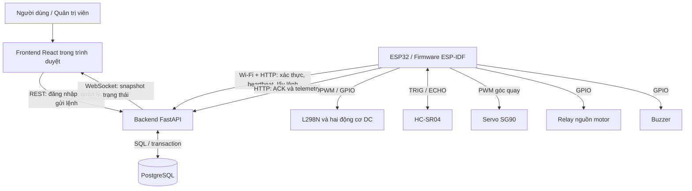
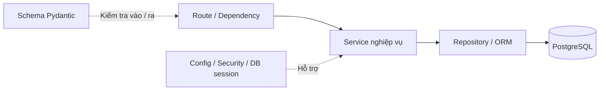
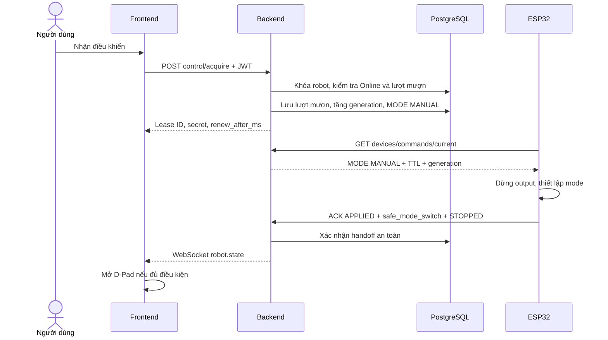
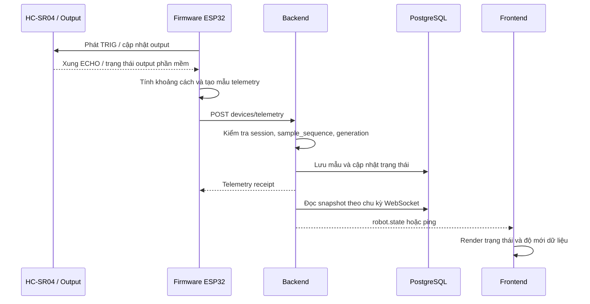

# CÔNG NGHỆ, KIẾN TRÚC VÀ NGUYÊN LÝ HOẠT ĐỘNG CỦA WEBSITE SMARTROBOT


## 1. Mục tiêu và phạm vi hệ thống

Website SmartRobot cung cấp các chức năng chính:

- Đăng nhập, duy trì phiên và phân quyền USER/ADMIN.
- Xem danh sách xe, tìm kiếm/lọc và theo dõi trạng thái Online, Offline, Busy.
- Nhận quyền điều khiển độc quyền một xe, chọn Manual hoặc Auto, trả xe sau khi sử dụng.
- Điều khiển thủ công bằng D-Pad, bàn phím WASD hoặc các phím mũi tên.
- Theo dõi chế độ, chuyển động do firmware báo cáo, khoảng cách, vật cản, buzzer và kết quả xử lý lệnh.
- Quản trị tài khoản, xe và cấp/đổi thông tin xác thực thiết bị.

Hệ thống hiện thực gồm bốn phần: frontend, backend, cơ sở dữ liệu và firmware. Trình duyệt giao tiếp với backend; ESP32 cũng giao tiếp với backend qua Wi-Fi. Quyết định tránh vật cản và việc phát tín hiệu GPIO/PWM được thực hiện cục bộ trên ESP32.

## 2. Công nghệ sử dụng

### 2.1. Frontend

| Công nghệ | Phiên bản khai báo trong `frontend/package.json` | Vai trò |
| --- | --- | --- |
| React, React DOM | `^19.3.1` | Xây dựng giao diện bằng component và cập nhật theo trạng thái |
| TypeScript | `~6.0.3` | Định nghĩa kiểu dữ liệu người dùng, xe, lệnh và telemetry |
| Vite | `^8.3.6` | Chạy môi trường phát triển, proxy API/WebSocket và build frontend |
| React Router DOM | `^7.18.5` | Điều hướng trong ứng dụng một trang |
| TanStack React Query | `^5.107.1` | Truy vấn, cache và cập nhật dữ liệu từ backend |
| Tailwind CSS | `^4.3.5` | Xây dựng kiểu dáng giao diện |
| Lucide React | `^1.73.0` | Cung cấp biểu tượng |
| Vitest, Testing Library, jsdom | Theo manifest/lockfile | Kiểm thử logic và tương tác giao diện |

Đây là khoảng phiên bản dependency được khai báo; bản cài đặt tái lập theo `frontend/package-lock.json`. Frontend dùng `fetch` cho HTTP và API `WebSocket` của trình duyệt cho cập nhật trạng thái.

### 2.2. Backend và dữ liệu

| Công nghệ | Vai trò trong dự án |
| --- | --- |
| Python 3.12 trở lên | Ngôn ngữ backend |
| FastAPI | Định nghĩa REST API, WebSocket, dependency và OpenAPI |
| Uvicorn | Chạy ứng dụng ASGI |
| Pydantic / Pydantic Settings | Kiểm tra payload và đọc cấu hình môi trường |
| SQLAlchemy 2.x | Ánh xạ model, truy vấn và transaction |
| Psycopg 3 | Driver kết nối PostgreSQL |
| PostgreSQL 18 | Lưu tài khoản, phiên, lượt mượn, lệnh, telemetry và nhật ký |
| Alembic | Quản lý migration schema; revision hiện tại là `0005_persistent_borrow` |
| PyJWT | Tạo/kiểm tra access token JWT, thuật toán HS256 |
| Argon2-cffi | Băm mật khẩu bằng Argon2id |
| Docker Compose | Khởi tạo PostgreSQL và volume dữ liệu trong môi trường local |
| uv, pytest, Ruff | Quản lý môi trường Python, kiểm thử và kiểm tra mã |

Backend khai báo dependency trong `backend/pyproject.toml`; phiên bản cụ thể được khóa trong `backend/uv.lock`. `compose.yaml` hiện chỉ khai báo dịch vụ PostgreSQL; backend và frontend được chạy riêng theo README.

### 2.3. Firmware và phần cứng

Firmware viết bằng C, sử dụng ESP-IDF và FreeRTOS, được build bằng PlatformIO với platform `espressif32@7.1.1`, board `esp32dev`. Các thành phần chính gồm Wi-Fi, HTTP(S) client, cJSON, NVS, GPIO, LEDC PWM, ngắt đọc cảm biến và các task điều khiển.

ESP32 nhận cấu hình Wi-Fi, backend URL, Device ID, Device Secret và tham số vận hành từ NVS. Cấu hình riêng được tạo bằng `firmware/tools/provision.py`; thông tin này không được nhúng vào source hay app image. Firmware hiện chưa có OTA.

## 3. Kiến trúc tổng thể



### 3.1. Trách nhiệm từng tầng

| Tầng | Trách nhiệm |
| --- | --- |
| Frontend | Thu nhận thao tác, hiển thị dữ liệu, gửi lệnh có thứ tự, ngừng duy trì chuyển động khi mất điều kiện điều khiển |
| Backend | Xác thực, phân quyền, kiểm tra lượt mượn, quản lý vòng đời lệnh và trạng thái, cung cấp API cho web/thiết bị |
| PostgreSQL | Nguồn dữ liệu bền vững cho quyền điều khiển, sequence/generation, lịch sử và báo cáo thiết bị |
| Firmware | Kiểm tra hiệu lực lệnh, thực thi state machine Manual/Auto, đọc cảm biến, điều khiển output và dừng qua watchdog |
| Mạch điện | Cấp nguồn, khuếch đại dòng cho động cơ, đo vật cản và tạo chuyển động/cảnh báo |

WebSocket phục vụ cập nhật từ backend về trình duyệt; lệnh điều khiển đi qua REST. ESP32 chủ động gọi HTTP API để lấy lệnh hiện hành, không mở kết nối WebSocket với web. Repository hiện không sử dụng MQTT hoặc broker thông điệp cho đường điều khiển.

### 3.2. Vì sao tách điều khiển phần cứng khỏi giao diện?

Trình duyệt và mạng có thể bị chậm, ẩn tab hoặc mất kết nối. Vì vậy, chu kỳ đọc cảm biến, kiểm tra vật cản và ngắt output phải hoạt động trên ESP32, độc lập với tốc độ render giao diện. Backend kiểm soát ai được gửi lệnh và lệnh nào còn hiệu lực; firmware quyết định có đủ điều kiện để áp dụng output hay không.

## 4. Kiến trúc frontend và nguyên lý hoạt động website

### 4.1. Phân chia mã nguồn

| Thư mục/file | Chức năng |
| --- | --- |
| `src/main.tsx`, `src/App.tsx` | Khởi tạo React, router và context |
| `src/routes/` | Khai báo đường dẫn và bảo vệ route theo phiên/role |
| `src/contexts/` | Duy trì trạng thái đăng nhập |
| `src/layouts/` | Bố cục ứng dụng, quản trị và trang dữ liệu xe |
| `src/pages/` | Các màn hình đăng nhập, dashboard, điều khiển, quản trị |
| `src/components/control/` | D-Pad, chọn mode, lượt mượn, hiển thị vật cản và ACK |
| `src/hooks/useRobots.ts` | Truy vấn danh sách/chi tiết xe |
| `src/hooks/useRobotControl.ts` | Phối hợp quyền điều khiển, socket, renew, giữ/nhả nút |
| `src/services/api.ts` | HTTP client, access token, refresh và CSRF |
| `src/services/robotControlService.ts` | Tuần tự hóa request điều khiển và loại bỏ ý định di chuyển đã cũ |
| `src/services/robotWebSocket.ts` | Xác thực socket, nhận state, reconnect và phát hiện mất phản hồi |
| `src/types/` | Hợp đồng kiểu dữ liệu frontend |

### 4.2. Các trang chính

| Đường dẫn | Nội dung |
| --- | --- |
| `/login` | Đăng nhập |
| `/dashboard` | Danh sách xe và trạng thái |
| `/robots/:id` | Nhận/trả xe, Manual/Auto và theo dõi telemetry |
| `/admin` | Trang tổng quan quản trị |
| `/admin/users` | Quản lý người dùng |
| `/admin/robots` | Quản lý xe và credential thiết bị |
| `/403` | Thông báo không đủ quyền |

`ProtectedRoute` yêu cầu đăng nhập; `AdminRoute` yêu cầu role ADMIN. Backend tiếp tục kiểm tra quyền ở mỗi API, kể cả khi người dùng bỏ qua kiểm tra trên giao diện.

### 4.3. Từ khi mở website đến khi hiển thị xe

1. Trình duyệt tải HTML, JavaScript và CSS; React khởi tạo ứng dụng một trang.
2. Lớp xác thực khôi phục phiên qua refresh cookie nếu có, lấy access token và thông tin người dùng.
3. Router cho phép vào trang phù hợp với phiên và role.
4. React Query gọi API lấy danh sách hoặc chi tiết xe. Các truy vấn xe tự cập nhật mỗi 5 giây khi phù hợp; danh sách không polling nền khi tab bị ẩn.
5. Tại trang điều khiển, frontend mở WebSocket theo ID xe và gửi access token trong frame xác thực đầu tiên.
6. Backend trả snapshot `robot.state`; giao diện kết hợp dữ liệu này với quyền mượn, kết nối và xác nhận mode để quyết định có mở D-Pad hay không.

Khi WebSocket chưa kết nối, frontend có thể đọc state bằng REST mỗi 5 giây. Dữ liệu fallback phục vụ quan sát; nó không tự mở quyền lái xe khi kênh điều khiển chưa đáp ứng điều kiện.

### 4.4. Xác thực và quản lý phiên

Access token được giữ trong bộ nhớ JavaScript, không lưu vào localStorage. Backend mặc định cấp access token 15 phút; refresh token mặc định 7 ngày, đi qua cookie HttpOnly và có cơ chế xoay token. Các thao tác cookie nhạy cảm kiểm tra Origin/CSRF; frontend đọc cookie CSRF và gửi `X-CSRF-Token`.

Nếu request trả 401, HTTP client phối hợp một lần refresh dùng chung cho các request đồng thời rồi thử lại. Web Locks được dùng khi trình duyệt hỗ trợ để tuần tự hóa xoay cookie giữa các tab. Phiên bị thu hồi hoặc refresh thất bại khiến frontend xóa trạng thái phiên và khóa thao tác.

## 5. Kiến trúc backend và cơ sở dữ liệu

### 5.1. Các lớp xử lý



- **Route/dependency:** nhận request, lấy danh tính người dùng/thiết bị, kiểm tra dữ liệu và trả response.
- **Service:** xử lý đăng nhập, quản trị, lượt mượn, TTL, ACK, telemetry và thay đổi trạng thái.
- **Repository/ORM:** truy vấn và cập nhật dữ liệu; các service có thể thao tác ORM trong transaction nghiệp vụ.
- **WebSocket:** kiểm tra lại quyền rồi đọc snapshot từ database theo chu kỳ.
- **Cleanup loop:** chạy cùng vòng đời ứng dụng, xử lý lệnh hết hạn và dọn lịch sử theo chính sách.

`backend/app/main.py` tạo FastAPI, CORS, database engine/session factory và cleanup task. Ứng dụng không tự tạo bảng khi startup; schema được cập nhật bằng Alembic.

### 5.2. Dữ liệu được lưu

| Bảng | Vai trò |
| --- | --- |
| `users` | Tài khoản, mật khẩu băm, role và trạng thái kích hoạt |
| `auth_sessions`, `refresh_tokens` | Phiên đăng nhập, refresh token và thu hồi phiên |
| `login_rate_limits` | Theo dõi giới hạn thử đăng nhập |
| `robots` | Danh tính xe, credential hash, active và heartbeat gần nhất |
| `control_sessions` | Chủ lượt mượn, binding phiên đăng nhập, lease secret dạng hash, thời điểm bắt đầu/kết thúc |
| `robot_control_states` | Mode yêu cầu/thực tế, trạng thái điều khiển, sequence/generation |
| `robot_commands` | Nội dung, hạn sử dụng, trạng thái và kết quả xác nhận lệnh |
| `device_sessions` | Phiên thiết bị gắn với boot ID |
| `robot_telemetry` | Các mẫu báo cáo cảm biến/chuyển động theo phiên thiết bị |
| `audit_logs` | Nhật ký nghiệp vụ/quản trị |

Khóa dòng robot và ràng buộc unique bảo đảm mỗi robot có tối đa một lượt mượn chưa đóng, ngay cả khi hai người cùng bấm nhận xe. Sequence/generation được lưu bền vững, không phụ thuộc vào một kết nối socket hoặc biến trong RAM của backend.

Mặc định lịch sử lệnh giới hạn 1.000 lệnh/xe và có chính sách dọn lệnh đã kết thúc cũ hơn 7 ngày; telemetry giới hạn 10.000 mẫu/xe và 7 ngày. Việc dọn lịch sử không đặt lại bộ đếm thứ tự chống phát lại lệnh.

### 5.3. Các nhóm API

Mọi đường dẫn dưới đây nằm dưới `/api/v1`:

| Nhóm | Chức năng |
| --- | --- |
| `/auth/*` | Đăng nhập, refresh, đăng xuất và thông tin người dùng |
| `/robots`, `/robots/{robot_id}` | Đọc danh sách/chi tiết xe |
| `/admin/*` | Quản trị tài khoản, xe và credential |
| `/robots/{robot_id}/control/*` | Nhận, renew, trả xe, đọc state, đổi mode, move, stop |
| `/ws/robots/{robot_id}` | Snapshot realtime cho trình duyệt |
| `/devices/*` | Xác thực, heartbeat, giao lệnh, ACK và telemetry cho ESP32 |
| `/health`, `/health/ready` | Kiểm tra tiến trình và kết nối database |

## 6. Quyền mượn xe và vòng đời lệnh

### 6.1. Phân biệt lượt mượn với quyền chuyển động

Lượt mượn hiện tại có `expires_at=null`: không tự hết hạn chỉ vì người dùng nhả nút, đóng tab, mất mạng hoặc đăng xuất. Trong sử dụng bình thường, thao tác **Trả xe** mới đóng lượt mượn. Vô hiệu hóa người dùng/xe hoặc thay credential có thể thu hồi quyền theo thao tác quản trị.

Quyền gửi lệnh vẫn cần phiên đăng nhập hợp lệ và binding đúng với lượt mượn. Cùng tài khoản có thể lấy lại lượt mượn sau reload/đăng nhập: backend đổi lease secret, gắn phiên mới, reset `client_sequence`, tăng `generation` và yêu cầu xác nhận Manual an toàn. ADMIN không tự chiếm lượt mượn của người khác qua acquire.

Lượt mượn còn mở không có nghĩa động cơ luôn được chạy. MOVE, chuyển mode và Auto permit đều có TTL ngắn; mất điều kiện hợp lệ sẽ dừng chuyển động trong khi lượt mượn được giữ lại.

### 6.2. Bốn trường chống trùng và sai thứ tự

| Trường | Ý nghĩa |
| --- | --- |
| `request_id` | UUID của một thao tác; retry giữ nguyên key để không tạo thêm lệnh |
| `client_sequence` | Thứ tự tăng theo lượt mượn ở phía frontend; request mới có số cũ bị từ chối |
| `sequence` | Thứ tự do server cấp, tăng theo robot trong suốt vòng đời |
| `generation` | Thế hệ điều khiển; tăng khi acquire, STOP, đổi mode hoặc đóng quyền để vô hiệu hóa lệnh cũ |

Lệnh mới thay thế ý định hiện hành; hệ thống không tích lũy một hàng đợi chuyển động để chạy bù sau reconnect. Retry cùng `request_id` và cùng nội dung trả lại lệnh hiện có; nội dung khác dùng cùng key bị từ chối.

### 6.3. Vòng đời và ý nghĩa xác nhận

Luồng thành công thông thường là `ACCEPTED → RECEIVED → APPLIED`; các nhánh khác gồm `REJECTED`, `FAILED`, `SUPERSEDED`, `EXPIRED`.

- HTTP `202` / `ACCEPTED`: backend đã tiếp nhận và lưu yêu cầu.
- `RECEIVED`: firmware xác nhận đã nhận lệnh.
- `APPLIED`: firmware báo đã chấp nhận áp dụng lệnh.
- `SUPERSEDED` / `EXPIRED`: lệnh đã mất quyền thực thi vì bị thay thế hoặc hết TTL.

ACK không chứng minh bánh xe đã quay hoặc xe đã di chuyển một quãng đường. Hệ thống chưa có encoder đo tốc độ bánh; `actual_movement` là trạng thái output do firmware báo cáo. UI phải dựa trên telemetry còn mới để hiển thị trạng thái, không suy ra chuyển động chỉ từ thao tác bấm nút.

## 7. Luồng xử lý giữa website và ESP32

### 7.1. Khởi động và đưa xe Online

1. Nguồn từ pin đi qua công tắc và Buck theo `Hardware.MD`; ESP32 khởi động với output ở trạng thái dừng.
2. Firmware khởi tạo GPIO, motor, servo, đọc cấu hình NVS và tạo các task. Thiếu/sai cấu hình khiến output giữ tắt.
3. ESP32 kết nối Wi-Fi; khi dùng HTTPS, đồng bộ thời gian để kiểm tra chứng chỉ.
4. Thiết bị gọi `POST /devices/authenticate` với boot ID, firmware version, header `X-Device-ID` và `X-Device-Secret`.
5. Backend kiểm tra credential, cấp `device_session_id`, thời gian server, sequence/generation và các chu kỳ giao tiếp.
6. Các request tiếp theo gửi thêm `X-Device-Session`. Heartbeat hợp lệ cập nhật `last_seen_at`; chỉ authenticate, telemetry hoặc poll không thay thế heartbeat.
7. Backend tính trạng thái: heartbeat quá 15 giây là Offline; còn mới là Online; Online có lượt mượn hợp lệ là Busy. Xe mới chưa có heartbeat luôn Offline.

Mỗi lần thiết lập phiên thiết bị mới phải xử lý fence lệnh cũ. Reboot không tự trả xe cho người khác và không được phát lại ý định chuyển động từ trước reboot.

### 7.2. Nhận quyền điều khiển và xác nhận Manual



Đổi mode không được mở khóa chỉ vì nhận `202`. ACK handoff phải khớp command ID, sequence, generation và TTL, đồng thời có `safe_mode_switch=true`, `actual_mode` đúng yêu cầu và `actual_movement=STOPPED`.

Lease secret chỉ tồn tại trong bộ nhớ của luồng điều khiển frontend, không ghi vào browser storage hoặc Query cache; database lưu hash của secret.

### 7.3. Điều khiển thủ công

1. Người dùng giữ D-Pad hoặc phím di chuyển; frontend kiểm tra quyền mượn, WebSocket và Manual đã xác nhận.
2. Frontend gọi `POST /robots/{id}/control/move` với lease ID/secret, request ID, client sequence và hướng đi.
3. Backend kiểm tra JWT, phiên, chủ lượt mượn, tình trạng xe, mode và thứ tự; lưu MOVE với TTL mặc định 700 ms.
4. ESP32 poll lệnh hiện hành, kiểm tra danh tính phiên, sequence/generation và deadline, sau đó ACK nhận/xử lý lệnh.
5. Control task kiểm tra cảm biến và điều kiện nguồn; nếu hợp lệ, xuất PWM qua L298N để điều khiển bánh.
6. Khi tiếp tục giữ, frontend đợi request hoàn tất rồi lên lịch MOVE tiếp theo sau 250 ms. Đây không phải tốc độ cố định khi mạng chậm.
7. Khi nhả/cancel, frontend bỏ ý định MOVE đang chờ và gửi STOP. Backend tăng generation, vô hiệu hóa chuyển động cũ; thiết bị dừng PWM khi nhận trạng thái mới hoặc khi deadline cũ hết hạn.
8. Firmware gửi telemetry; backend lưu và trả snapshot cho web.

Ví dụ body MOVE, với các giá trị minh họa cần thay bằng UUID/secret thật trong bộ nhớ:

```json
{
  "control_session_id": "<UUID lượt mượn>",
  "lease_token": "<secret lượt mượn>",
  "request_id": "<UUID thao tác>",
  "client_sequence": 1,
  "direction": "FORWARD"
}
```

Hướng hợp lệ gồm `FORWARD`, `BACKWARD`, `TURN_LEFT`, `TURN_RIGHT`; STOP đi qua endpoint `/stop`. Giao diện hiện không có nút STOP riêng; nhả nút là thao tác dừng Manual.

### 7.4. Chuyển Auto và duy trì permit

Frontend gọi `POST control/mode` với `AUTO`. Backend tăng generation và tạo MODE/AUTO, đồng thời khóa điều khiển khi mode đang pending. Firmware dừng chuyển động cũ, xác nhận handoff an toàn, rồi mới cho state machine Auto hoạt động.

Frontend renew theo `renew_after_ms`, mặc định 1.500 ms. Ở Auto, backend cấp KEEPALIVE/AUTO hữu hạn, mặc định TTL 3.000 ms. `direction=STOP` trong MODE/KEEPALIVE mô tả envelope cấp mode/permit; firmware diễn giải theo `kind` và `mode`, sau handoff mới chạy thuật toán tự hành.

Khi permit hết hạn, firmware hủy Auto và dừng. Kết nối phục hồi cần permit/handoff hợp lệ mới; không tiếp tục thuật toán bằng lệnh cũ. Backend có thể giữ mode đã chọn để renew khôi phục handoff.

### 7.5. Dữ liệu từ phần cứng trở lại web



Telemetry gồm `robot_id`, `sample_sequence`, sequence/generation, mode, chuyển động, khoảng cách, trạng thái vật cản và buzzer. Mẫu trùng không làm mới freshness. Dữ liệu khoảng cách phải hữu hạn và không âm; lỗi cảm biến có thể biểu diễn bằng `distance_cm=null` và `SENSOR_ERROR`.

Backend WebSocket đọc database mỗi giây theo mặc định, gửi `robot.state` khi thay đổi hoặc `ping` nếu không đổi. Đây là snapshot định kỳ, không phải tín hiệu đẩy trực tiếp từ cảm biến hoặc PostgreSQL. UI cần xem `telemetry_fresh` và thời điểm báo cáo, hiển thị chưa có dữ liệu/chưa xác nhận khi phù hợp.

### 7.6. Trả xe

Frontend ngừng MOVE, cố gắng gửi STOP rồi gọi `POST control/release`. Backend đóng lượt mượn, tăng generation và không giao lệnh thuộc lượt mượn đã đóng. ESP32 nhận envelope không còn quyền/lượt mượn, hủy Auto, dừng PWM và ngắt relay. Nếu request/truyền tin bị mất, TTL và watchdog vẫn giới hạn chuyển động còn lại.

Đóng tab hoặc logout ngừng duy trì chuyển động nhưng không tương đương với Trả xe. Người dùng cùng tài khoản có thể lấy lại lượt mượn sau khi mở lại web.

## 8. Liên hệ firmware với phần cứng trong Hardware.MD

### 8.1. Ánh xạ tín hiệu và công dụng

| Khối phần cứng | GPIO/cấu hình hiện tại | Cách tham gia luồng điều khiển |
| --- | --- | --- |
| ESP32 DevKit V1 | Vi điều khiển trung tâm | Nhận lệnh qua Wi-Fi, xử lý logic và điều khiển output |
| L298N IN1/IN2 | GPIO19/GPIO21 | Điều khiển bánh phải, OUT1/OUT2 |
| L298N IN3/IN4 | GPIO5/GPIO18 | Điều khiển bánh trái, OUT3/OUT4 |
| HC-SR04 TRIG/ECHO | GPIO27/GPIO14 | Phát xung kích hoạt và đo độ rộng xung phản hồi |
| Servo SG90 | GPIO13; trái 0°, giữa 90°, phải 180° | Quay cảm biến để kiểm tra hướng |
| Relay | GPIO26, active-low | LOW bật nguồn motor; HIGH ngắt nguồn motor |
| Buzzer | GPIO12, active-high | Báo vật cản/lỗi theo logic firmware |
| Pin, SW1, Buck, đầu nối | Mạch nguồn và dây kết nối | Cấp điện và truyền tín hiệu giữa các tầng |
| LED D1, R1 | Báo nguồn theo mạch | Hoạt động theo đường cấp nguồn, không phải chỉ báo Online do web điều khiển |

### 8.2. Từ lệnh chuyển động đến PWM

L298N dùng hai cầu H để đảo chiều điện áp trên hai động cơ. Firmware đặt PWM trực tiếp trên IN1–IN4, tần số 1 kHz, độ phân giải 8 bit. Không có GPIO ENA/ENB; sơ đồ giả định jumper enable được lắp đúng.

| Lệnh | IN1 | IN2 | IN3 | IN4 |
| --- | --- | --- | --- | --- |
| Tiến | PWM | 0 | PWM | 0 |
| Lùi | 0 | PWM | 0 | PWM |
| Quay trái | 0 | PWM | PWM | 0 |
| Quay phải | PWM | 0 | 0 | PWM |
| Dừng | 0 | 0 | 0 | 0 |

Firmware đưa đầu ra về 0 trước khi đổi cực tính. Duty mặc định `full/slow/turn = 75/30/75` trên thang 0–255, không phải phần trăm tốc độ cơ khí. Bù PWM mặc định bánh trái/phải là 100%/83,5%; duty được nhân hệ số, làm tròn và giới hạn ở 255. Chiều cơ khí còn phụ thuộc đấu dây motor thực tế.

Relay quản lý nguồn theo lượt mượn được thiết bị xác nhận, với điều kiện `motors_enabled=true` và không có trạng thái lỗi/reset chặn nguồn. Manual đứng yên hoặc STOP thông thường dừng PWM nhưng vẫn giữ relay ON. Firmware chờ nguồn ổn định 50 ms sau khi bật relay trước khi cho PWM. Trả xe hoặc watchdog/lỗi yêu cầu reset sẽ ngắt relay.

### 8.3. Đọc cảm biến và bảo vệ Manual

Firmware phát TRIG mức cao 10 µs, thu cạnh lên/xuống ECHO bằng ngắt và tính:

`distance_cm = echo_width_us × 0,0343 / 2`

Mẫu chỉ hợp lệ trong giới hạn kiểm tra của firmware, gồm khoảng cách 2–400 cm và độ rộng xung không quá 25.000 µs. Sensor task chờ phản hồi tối đa khoảng 30 ms và nghỉ 60 ms sau mỗi lần đo. Không có echo được coi là mẫu lỗi, không suy ra phía trước thông thoáng.

Mẫu dùng cho chuyển động phải đúng hướng giữa, servo ổn định và không cũ quá 250 ms. Manual tiến gặp khoảng cách dưới 15 cm phải dừng; lệnh MOVE bị chặn không tự chạy lại chỉ vì vật cản đã rời đi, cần lệnh hợp lệ tiếp theo.

Do chỉ có cảm biến phía trước, Manual lùi/quay yêu cầu `allow_blind_manual=true`. Đợt chuyển động này mặc định tối đa 300 ms; giữ nút/gửi lệnh lặp không kéo dài liên tục đợt mù, cần nhả/STOP để mở đợt mới.

### 8.4. Thuật toán Auto hiện tại

Thuật toán được thực hiện trong `firmware/src/auto.c` theo các trạng thái có thể hủy:

1. **Đi thẳng:** khoảng cách từ 40 cm trở lên dùng `full_speed`; từ 15 đến dưới 40 cm dùng `slow_speed`.
2. **Vật cản dưới 15 cm:** dừng và quay servo sang trái 0°.
3. **Kiểm tra trái:** chờ servo ổn định 600 ms và lấy mẫu hợp lệ. Trái từ 15 cm trở lên được ưu tiên chọn ngay.
4. **Kiểm tra phải:** nếu trái bị chắn hoặc không có mẫu hợp lệ trong cửa sổ chờ, quay sang phải 180°; phải từ 15 cm trở lên thì chọn phải.
5. **Có hướng đi:** đưa servo về giữa, chờ dữ liệu giữa hợp lệ, lùi mặc định 400 ms, đưa output về dừng 100 ms, quay hướng đã chọn mặc định 400 ms, dừng 100 ms và đo lại.
6. **Hai bên bị chắn:** đưa servo về giữa và kiểm tra lại, không coi mẫu lỗi là đường trống.
7. **Heuristic kẹt:** trong pha đi thẳng, khoảng cách không thay đổi quá 5 cm trong 3 giây kích hoạt nhánh lùi/quay trái. Đây là suy đoán từ khoảng cách, không phải phép đo bánh xe bị kẹt.

Auto ưu tiên trái theo thứ tự kiểm tra, không so sánh rồi chọn bên có khoảng cách lớn nhất. Các bước lùi/quay vẫn chịu permit, watchdog và kiểm tra dữ liệu cảm biến; một cảm biến phía trước không quan sát trực tiếp được khoảng trống phía sau hoặc hai bên khi xe di chuyển.

Buzzer bật khi có mẫu mới dưới 15 cm; trong Auto, vùng 15–dưới 40 cm tạo cảnh báo ngắt quãng theo nhịp phần mềm. Khi cảm biến lỗi và xe đang được cấp quyền, logic cũng có thể bật cảnh báo. Web chỉ hiển thị trạng thái do thiết bị gửi.

### 8.5. Những điểm cần đối chiếu với sơ đồ điện

`Hardware.MD` mô tả khả năng phần cứng tổng quát; mã nguồn bổ sung giao thức HTTP, PWM trên IN1–IN4, cực tính relay và state machine cụ thể. Các điểm điện đã được chính tài liệu phần cứng đánh dấu cần xác minh vẫn áp dụng:

- R2 10 Ω/2 W mắc nối tiếp VIN không phải bộ ổn áp; cần kiểm tra điện áp nguồn ESP32 khi dòng tải thay đổi.
- Sơ đồ thể hiện ECHO HC-SR04 về GPIO14; cần xử lý mức tín hiệu phù hợp 3,3 V trước khi đưa vào ESP32.
- `BAT_PROTECTED+` là tên đường nguồn, chưa đủ để xác nhận đã có BMS trong bản vẽ.
- ENA/ENB, chung GND và khả năng cấp dòng nguồn motor/servo phải đúng với mạch thực tế để các output phần mềm có tác dụng.

## 9. Chu kỳ xử lý, mất kết nối và giới hạn quan sát

### 9.1. Các mốc thời gian chính

| Cơ chế | Mặc định/đặc điểm |
| --- | --- |
| Frontend lặp MOVE khi giữ | 250 ms sau khi request trước hoàn tất |
| Timeout POST điều khiển frontend | 900 ms |
| TTL MOVE/STOP | 700 ms |
| TTL MODE/Auto permit | 3.000 ms |
| Renew frontend | 1.500 ms với cấu hình mặc định |
| ESP32 poll lệnh | Chu kỳ backend đề nghị 100 ms; thực tế chịu thời gian request và lập lịch |
| ESP32 heartbeat | 2.000 ms |
| Backend tính Offline | Heartbeat cũ hơn 15 giây |
| Khoảng tối thiểu giữa telemetry | 200 ms; tương đương giới hạn nhận mới mặc định 5 Hz |
| Backend WebSocket snapshot | 1.000 ms |
| Frontend WebSocket watchdog | Không có state/ping trong 4 giây thì ngắt |
| Firmware control task | Tick mục tiêu 10 ms |
| Firmware safety task | Chu kỳ mục tiêu 20 ms |
| Firmware watchdog poll | Khoảng 1 giây từ lần chứng minh giao tiếp điều khiển hợp lệ gần nhất |
| Servo ổn định / tuổi mẫu cảm biến | 600 ms / tối đa 250 ms |

Heartbeat, poll, TTL và WebSocket giải quyết các vấn đề khác nhau. Xe có thể vẫn Online nhưng không còn quyền chuyển động vì MOVE hết TTL; cũng có thể còn lượt mượn nhưng bị watchdog dừng. Không sử dụng ngưỡng Offline 15 giây làm thời gian duy nhất để ngắt động cơ.

### 9.2. Xử lý các tình huống gián đoạn

| Tình huống | Phản ứng chính |
| --- | --- |
| Nhả nút/cancel | Bỏ MOVE đang chờ, gửi STOP, giữ lượt mượn |
| Blur hoặc tab ẩn khi giữ Manual | Ngừng intent đang giữ và cố gắng STOP |
| Blur/tab ẩn khi Auto | Không tự coi là Trả xe hay bắt buộc STOP; Auto còn phụ thuộc WS, renew và permit thực tế |
| Mất WebSocket | Khóa điều khiển, ngừng cấp permit theo luồng frontend; reconnect với backoff 0,5–5 giây |
| Mất Wi-Fi hoặc request thiết bị lỗi kéo dài | Firmware dừng/fence theo deadline, thiết lập lại phiên khi cần |
| Hết TTL MOVE | Dừng chuyển động; không kéo dài deadline chỉ vì retry |
| Hết Auto permit | Hủy Auto, dừng và yêu cầu cấp quyền/handoff hợp lệ lại |
| Cảm biến lỗi/cũ | Chặn chuyển động; pha quét bên có thể thử hướng còn lại khi xe đang đứng yên |
| Lệnh thuộc generation cũ | Không được tiếp tục thực thi hoặc ghi đè trạng thái mới |
| Logout/hết phiên đăng nhập | Ngừng quyền gửi lệnh, fence chuyển động; giữ lượt mượn để cùng tài khoản phục hồi |
| Trả xe | Đóng lượt mượn, dừng PWM và ngắt relay khi thiết bị nhận trạng thái hoặc watchdog tác động |

Control/safety task chạy tách khỏi task HTTP. Request mạng bị chậm không được giữ output quá deadline. Dù vậy, thời gian dừng vật lý còn phụ thuộc tải, quán tính, nguồn, driver và mặt đường; muốn đánh giá thực tế cần đo trên xe.

## 10. Bảo mật và triển khai

Hai loại danh tính được tách riêng:

- **Người dùng:** JWT và auth session; quyền điều khiển bổ sung lease secret, chủ sở hữu và binding phiên.
- **Thiết bị:** Device ID/Secret và device session; không dùng JWT người dùng để giả làm ESP32.

Mật khẩu dùng Argon2id; các secret/token thích hợp được lưu hash. Backend từ chối dữ liệu sai schema, kiểm tra session, thứ tự và generation. Không đưa token vào URL; frame xác thực WebSocket phải đến trong 5 giây và Origin phải hợp lệ.

Trong môi trường local, Vite chạy `127.0.0.1:5173`, proxy `/api` và WebSocket tới backend `127.0.0.1:8000`. Muốn ESP32 truy cập qua LAN phải bind backend ra giao diện mạng và dùng IP LAN của máy chủ trong cấu hình thiết bị. Địa chỉ `localhost` trên ESP32 không trỏ tới máy chạy backend.

HTTP Device API chỉ phục vụ thử nghiệm LAN khi backend và firmware cùng bật tùy chọn cho phép. Production yêu cầu HTTPS, secure cookies và origin cụ thể. Bản build `frontend/dist/` cần web server/reverse proxy có SPA fallback, chuyển tiếp `/api` và hỗ trợ WebSocket Upgrade. Proxy phát triển của Vite không nằm trong file build.

Wi-Fi/Device Secret nằm trong cấu hình NVS; NVS hiện chưa mã hóa trên flash. Website hiện chưa cung cấp hình ảnh camera, định vị, đo tốc độ bánh hoặc bằng chứng hành trình vật lý. Những dữ liệu này cần phần cứng và luồng xử lý bổ sung.

## 11. Tham chiếu mã nguồn và tài liệu

| Nội dung cần đối chiếu | Nguồn |
| --- | --- |
| Linh kiện, sơ đồ chân, nguồn và đầu nối | [Hardware.MD](Hardware.MD) |
| Cài đặt và vận hành toàn bộ hệ thống | [README.md](README.md) |
| Manifest frontend | [frontend/package.json](frontend/package.json) |
| Manifest backend và cấu hình mặc định | [backend/pyproject.toml](backend/pyproject.toml), [config.py](backend/app/core/config.py) |
| Trang và điều phối điều khiển web | [AppRoutes.tsx](frontend/src/routes/AppRoutes.tsx), [useRobotControl.ts](frontend/src/hooks/useRobotControl.ts) |
| Gửi lệnh và nhận socket | [robotControlService.ts](frontend/src/services/robotControlService.ts), [robotWebSocket.ts](frontend/src/services/robotWebSocket.ts) |
| Nghiệp vụ điều khiển và thiết bị | [control.py](backend/app/services/control.py), [devices.py](backend/app/services/devices.py) |
| Snapshot WebSocket | [robots.py](backend/app/websocket/robots.py) |
| Schema Device API | [devices.py](backend/app/schemas/devices.py) |
| GPIO và tham số phần cứng | [board.h](firmware/src/board.h) |
| Task khởi động và giao tiếp thiết bị | [main.c](firmware/src/main.c), [device.c](firmware/src/device.c) |
| Điều khiển, Manual, Auto và watchdog | [robot.c](firmware/src/robot.c), [manual.c](firmware/src/manual.c), [auto.c](firmware/src/auto.c), [safety.c](firmware/src/safety.c) |
| Đọc cảm biến và phát PWM motor | [sensor.c](firmware/src/sensor.c), [motor.c](firmware/src/motor.c) |
| Hợp đồng điều khiển chi tiết | [robot-control-protocol.md](docs/robot-control-protocol.md) |
| Payload và endpoint cho ESP32 | [esp32-device-api.md](docs/esp32-device-api.md) |

Các báo cáo phase và ghi chú sửa lỗi mô tả từng thời điểm phát triển; khi nội dung cũ khác hành vi hiện tại, cần đối chiếu mã nguồn và migration đang áp dụng. Đặc biệt, lượt mượn hiện không tự hết hạn như thiết kế lease ở các phase đầu, và Auto hiện ưu tiên kiểm tra trái trước.
