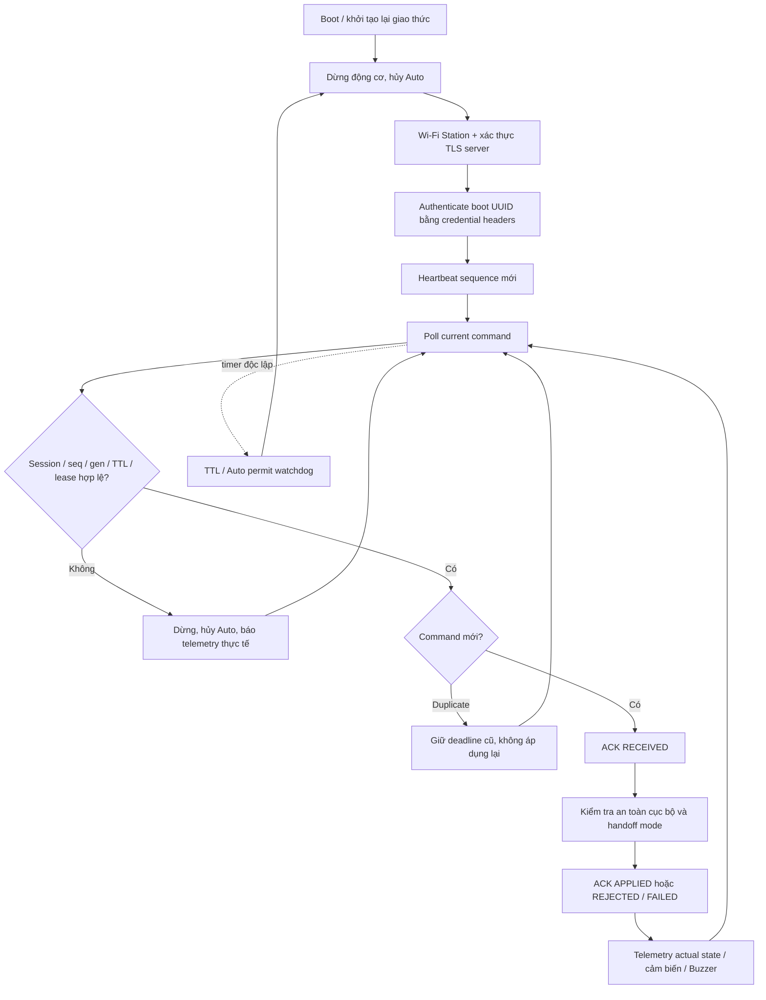

# ESP32 Device API — v1, Phase 6A

Hợp đồng cho firmware ESP-IDF Phase 6B. Backend đã triển khai; tài liệu này không chứa
firmware hoặc simulator. Payload ví dụ minh họa protocol, không phải dữ liệu thiết bị thật.

## 1. Kết nối và bảo mật

Base URL gồm `/api/v1/devices`, ví dụ `https://smartrobot.lan/api/v1/devices`.
ESP32 là Wi-Fi Station/HTTP Client, chủ động kết nối laptop; không chạy HTTP server và
backend không cần biết IP thiết bị. Mỗi xe phải dùng Device ID/credential riêng từ Admin.

Mọi endpoint yêu cầu:

```http
X-Device-ID: <device_id>
X-Device-Secret: <device_secret>
Content-Type: application/json
```

Sau authenticate, thêm `X-Device-Session: <device_session_id>`. Session ID là định danh boot,
không thay credential: **vẫn gửi cả ID và secret ở mỗi request**. Không dùng User JWT,
cookie, query parameters hoặc ESP32 WebSocket. JSON từ chối trường ngoài schema.

Backend chỉ lưu SHA-256 credential; Admin cấp một lần, rotate thu hồi secret cũ và device
session ngay. Device ID phân biệt hoa thường. Robot disable cũng bị từ chối xác thực.
Không log headers/body có credential, không bật curl verbose/trace hoặc HTTP debug dumps.

Mặc định HTTPS bắt buộc. Firmware cấu hình CA đáng tin và kiểm tra hostname server;
không tắt certificate/hostname verification. Laptop cần chứng chỉ có hostname/IP phù hợp,
ESP32 cần giờ hệ thống phù hợp để xác thực chứng chỉ. Dùng base URL cố định qua DHCP
reservation/DNS LAN; không dùng `localhost`/`127.0.0.1` trên ESP32 để gọi laptop.

Chỉ phát triển LAN riêng mới được đặt `DEVICE_ALLOW_INSECURE_HTTP=true`, dùng ví dụ
`http://192.168.1.10:8000/api/v1/devices`. Backend từ chối HTTP client IP công khai và
production không cho bật tùy chọn này. HTTP không mã hóa credential, không chống MITM;
không public listener lên Internet, không port-forward, firewall chỉ cho mạng phát triển.
Nếu cần reverse proxy, chỉ tin địa chỉ proxy đã cấu hình; không tin forwarded headers
tùy ý. HTTP qua proxy không phải cách triển khai công khai được hỗ trợ. Production dùng
HTTPS/WSS cùng xác thực chứng chỉ server. Không có MQTT hoặc simulator.

## 2. Bảng endpoints và thời gian

| Method/path tương đối | Request | Response thành công |
| --- | --- | --- |
| POST `/authenticate` | boot_id, firmware_version? | 200 cấu hình/session |
| POST `/heartbeat` | heartbeat_sequence | 200 heartbeat receipt |
| GET `/commands/current` | Không body/query | 200 envelope, command hoặc null |
| POST `/commands/ack` | ID/seq/gen/status và safe handoff khi cần | 200 ACK receipt |
| POST `/telemetry` | sample + actual fields | 200 telemetry receipt |

Mọi response `Cache-Control: no-store`. Timestamps RFC3339 UTC; chấp nhận cả hậu tố `Z`
và `+00:00` khi parse. Không dựa vào thứ tự keys JSON. ID là UUID strings, sequences là
số nguyên không âm/dương như mô tả, giới hạn request tối đa 9007199254740991 khi có cap.
Null là chưa có dữ liệu, không phải 0 cm hoặc đường an toàn.

| Thông số | Mặc định | Ý nghĩa |
| --- | --- | --- |
| heartbeat_interval_ms | 2000 | Gửi heartbeat mới; backend clamp <= offline timeout / 3 |
| offline_timeout_ms | 15000 | Chỉ heartbeat mới làm robot Online |
| poll_interval_ms | 100 | Poll latest command, không giữ hàng đợi lệnh chuyển động |
| telemetry_min_interval_ms | 200 | Tối đa 5 mẫu mới/giây mặc định |
| manual_command_ttl_ms | 700 | MOVE và STOP có hạn ngắn |
| mode_command_ttl_ms | 3000 | MODE/Auto KEEPALIVE có hạn ngắn |

Firmware đọc các thông số từ response authenticate, không hardcode chúng làm nguồn duy
nhất. Backend env: `DEVICE_HEARTBEAT_INTERVAL_MS`, `ROBOT_OFFLINE_AFTER_SECONDS`,
`DEVICE_POLL_INTERVAL_MS`, `DEVICE_TELEMETRY_MIN_INTERVAL_MS`, `MANUAL_COMMAND_TTL_MS`,
`MODE_COMMAND_TTL_MS`. Interval heartbeat hiệu dụng là min(cấu hình, timeout/3).

## 3. Authenticate và boot lifecycle

Firmware dừng động cơ/hủy Auto trước khi bắt đầu mạng. Mỗi boot hoặc khởi tạo lại phiên
giao thức sinh UUID ngẫu nhiên mới; giữ nguyên UUID khi retry cùng thao tác authenticate.
Không dùng boot counter lặp lại hoặc UUID cố định trong firmware.

```http
POST /api/v1/devices/authenticate
X-Device-ID: <device_id>
X-Device-Secret: <device_secret>
```

Request đầy đủ (`firmware_version` có thể bỏ hoặc null):

```json
{
  "boot_id": "11111111-1111-4111-8111-111111111111",
  "firmware_version": "6b-dev"
}
```

Response:

```json
{
  "protocol_version": 1,
  "robot_id": "22222222-2222-4222-8222-222222222222",
  "device_session_id": "33333333-3333-4333-8333-333333333333",
  "server_time": "2026-11-15T16:00:00Z",
  "sequence": 0,
  "generation": 1,
  "heartbeat_interval_ms": 2000,
  "offline_timeout_ms": 15000,
  "poll_interval_ms": 100,
  "telemetry_min_interval_ms": 200,
  "manual_command_ttl_ms": 700,
  "mode_command_ttl_ms": 3000
}
```

Authenticate không cập nhật heartbeat. Boot mới đóng device session cũ, hủy lease/lệnh
cũ, tăng generation, xóa actual state cached và giữ Offline tới heartbeat. Sequence lệnh
server không reset. Retry cùng boot đang active trả cùng session, không đóng lease lần nữa.
Boot đã retired trả 409; request mang session cũ cũng 409. Muốn khởi tạo lại sau rotate/
disable hoặc session retired: dừng, tạo boot UUID mới và authenticate lại bằng credential
hiện hành. Không tự động resume Auto/lệnh cache sau reboot.

Device session không có User JWT và không renew user lease. Không chia sẻ một Device ID
cho hai xe: boot mới sẽ thu hồi boot trước. Backend giữ tombstone boot IDs để chống request
auth đến muộn khôi phục phiên cũ; không prune tombstones theo telemetry retention.

## 4. Heartbeat

Headers credential + session bắt buộc. Counter bắt đầu 1, tăng cho mỗi heartbeat **mới**
trong boot; retry gói mất response giữ counter cũ. Body không nhận timestamp từ thiết bị.

```json
{"heartbeat_sequence": 1}
```

Response:

```json
{
  "robot_id": "22222222-2222-4222-8222-222222222222",
  "device_session_id": "33333333-3333-4333-8333-333333333333",
  "heartbeat_sequence": 1,
  "last_seen_at": "2026-11-15T16:00:01Z",
  "server_time": "2026-11-15T16:00:01Z",
  "sequence": 0,
  "generation": 1,
  "duplicate": false
}
```

Backend dùng giờ PostgreSQL UTC. Counter bằng lần gần nhất trả duplicate=true và giữ
nguyên last_seen_at; counter nhỏ hơn trả 409. Replay heartbeat không kéo dài Online.
Heartbeat trở lại sau Offline hủy lease cũ **trước** đánh dấu Online; cần user acquire
mới. Heartbeat không gia hạn MOVE, Auto permit hoặc control lease. Authenticate/poll/ACK/
telemetry không thay heartbeat.

## 5. Fetch current command và desired state

`GET /commands/current`, không body/query. Gửi đủ ba headers. Ví dụ sau user acquire:

```json
{
  "robot_id": "22222222-2222-4222-8222-222222222222",
  "device_session_id": "33333333-3333-4333-8333-333333333333",
  "server_time": "2026-11-15T16:00:02.100Z",
  "sequence": 1,
  "generation": 2,
  "requested_mode": "MANUAL",
  "mode_pending": true,
  "control_authorized": true,
  "authorization_expires_at": "2026-11-15T16:00:05Z",
  "lease_expires_at": "2026-11-15T16:00:12Z",
  "command": {
    "command_id": "44444444-4444-4444-8444-444444444444",
    "robot_id": "22222222-2222-4222-8222-222222222222",
    "control_session_id": "55555555-5555-4555-8555-555555555555",
    "sequence": 1,
    "generation": 2,
    "kind": "MODE",
    "mode": "MANUAL",
    "direction": "STOP",
    "issued_at": "2026-11-15T16:00:02Z",
    "expires_at": "2026-11-15T16:00:05Z",
    "status": "ACCEPTED",
    "acknowledgement": null,
    "acknowledged_at": null
  },
  "fail_safe": "STOP",
  "poll_interval_ms": 100
}
```

Trường `authorization_expires_at` là min(command expiry, lease expiry), chỉ có khi command
hợp lệ. Backend không trả lệnh hết TTL, sai generation/lease, robot Offline, lease hết
hạn/thu hồi; không trả cả STOP thuộc lease đã đóng. Poll lặp trả cùng ID/sequence và expiry,
không đánh dấu RECEIVED/APPLIED và không làm mới TTL.

Envelope idle không có lệnh, ví dụ sau release (sequence/generation thực tế sẽ khác):

```json
{
  "robot_id": "22222222-2222-4222-8222-222222222222",
  "device_session_id": "33333333-3333-4333-8333-333333333333",
  "server_time": "2026-11-15T16:00:06Z",
  "sequence": 3,
  "generation": 3,
  "requested_mode": "MANUAL",
  "mode_pending": true,
  "control_authorized": false,
  "authorization_expires_at": null,
  "lease_expires_at": null,
  "command": null,
  "fail_safe": "STOP",
  "poll_interval_ms": 100
}
```

**command=null hoặc control_authorized=false bắt buộc STOP/hủy Auto**, không phải tiếp tục
lệnh trước. Khi Manual đứng yên, lease có thể vẫn còn và mode_pending=false; null chỉ có
nghĩa chưa có chuyển động hợp lệ, firmware ở trạng thái dừng chờ MOVE mới. Không cần tạo
boot mới cho mỗi lần Manual idle. Requested mode không phải chứng cứ actual mode.

Firmware đối chiếu robot_id/device_session_id, ID lease, generation và high-water sequence.
Lệnh sequence thấp hơn hoặc thuộc generation/session cũ phải bỏ. Sequence bằng là duplicate:
không chạy lại, không cộng lại TTL. Thay generation hủy chuyển động/Auto cũ trước xử lý lệnh
mới. Backend giữ sequence/generation khi reboot và prune. Không xây queue để chạy lệnh cũ
sau reconnect. Client không được tự chỉ định sequence server.

Kind/direction:

| Kind | Mode/direction | Firmware cần làm |
| --- | --- | --- |
| MOVE | MANUAL, FORWARD/BACKWARD/TURN_LEFT/TURN_RIGHT | Áp dụng hướng trong TTL, chịu kiểm tra an toàn cục bộ |
| STOP | MANUAL, STOP | Dừng; không có nút Stop trên web |
| MODE | MANUAL hoặc AUTO, STOP | Dừng/cancel thuật toán cũ, safe handoff trước đổi mode |
| KEEPALIVE | AUTO, STOP | Chỉ gia hạn permit Auto đã được handoff, không phải MOVE tiến |

Web giữ nút tạo MOVE mới khoảng tối đa 4 Hz. Nhả/cancel tạo STOP thế hệ mới. Không có Stop
hoặc Emergency Stop button/API khẩn cấp. Requested direction STOP trong MODE/KEEPALIVE
không có nghĩa thuật toán Auto tự suy ra một hướng; firmware xử lý theo kind/mode.

## 6. ACK — nhận và áp dụng khác chuyển động vật lý

`POST /commands/ack`, đủ ba headers. Firmware có thể gửi RECEIVED trước khi áp dụng:

```json
{
  "command_id": "44444444-4444-4444-8444-444444444444",
  "sequence": 1,
  "generation": 2,
  "status": "RECEIVED",
  "safe_mode_switch": false,
  "actual_mode": null,
  "actual_movement": null
}
```

Sau MODE an toàn, firmware hủy chuyển động cũ, đặt trạng thái dừng rồi gửi:

```json
{
  "command_id": "44444444-4444-4444-8444-444444444444",
  "sequence": 1,
  "generation": 2,
  "status": "APPLIED",
  "safe_mode_switch": true,
  "actual_mode": "MANUAL",
  "actual_movement": "STOPPED"
}
```

Response:

```json
{
  "robot_id": "22222222-2222-4222-8222-222222222222",
  "command_id": "44444444-4444-4444-8444-444444444444",
  "sequence": 1,
  "status": "APPLIED",
  "acknowledged_at": "2026-11-15T16:00:02.200Z",
  "duplicate": false
}
```

| ACK | Ý nghĩa |
| --- | --- |
| RECEIVED | Firmware nhận/parse lệnh; chưa xác nhận áp dụng |
| APPLIED | Firmware đã chấp nhận áp dụng yêu cầu; không chứng minh xe đã di chuyển |
| REJECTED | Firmware từ chối lệnh; backend thu hồi lease |
| FAILED | Áp dụng thất bại; backend thu hồi lease |

MOVE/STOP Manual thông thường dùng safe_mode_switch=false, actual fields null/bỏ; báo
actual movement qua telemetry riêng. MODE APPLIED khi đang pending bắt buộc safe handoff,
actual mode khớp yêu cầu và actual movement STOPPED. Sai/thiếu trả 409; schema flag không
phù hợp trả 422. Auto → Manual chỉ cho MOVE sau ACK an toàn này. APPLIED không có safe
handoff không mở khóa Manual. Sau safe handoff, sensor fields cached được xóa để không
coi cảm biến cũ là dữ liệu mới; cần telemetry mới.

Ack phải khớp robot/ID/sequence/generation, lease còn quyền và command còn TTL. APPLIED,
FAILED, REJECTED là terminal: không hạ về RECEIVED hoặc thay nội dung. Retry body giống
lần gần nhất trả duplicate=true và timestamp cũ, không cập nhật trạng thái hoặc mở lại
lease. Receipt đã chấp nhận vẫn có thể được retry sau STOP/expiry nếu còn history, nhưng
không áp dụng lại; ACK cũ chưa từng nhận hoặc khác body bị 409. Hết history trả 409. Không
gửi một APPLIED rồi gửi FAILED như một lần thực thi khác; lỗi phát sinh sau đó báo telemetry
thực tế và chuyển thiết bị sang an toàn/khởi tạo lại phiên khi cần.

ACK lưu trạng thái logic của lệnh. `EXECUTED` chỉ là compatibility status nội bộ Phase 5,
không hợp lệ trong Device ACK API. UI chỉ báo Đã áp dụng yêu cầu; actual movement có thể
vẫn STOPPED vì vật cản hoặc điều kiện an toàn cục bộ.

## 7. Telemetry thực tế

`POST /telemetry`, đủ ba headers. Ví dụ thiết bị chặn tiến vì vật cản sau MOVE sequence 2:

```json
{
  "robot_id": "22222222-2222-4222-8222-222222222222",
  "sample_sequence": 1,
  "sequence": 2,
  "generation": 2,
  "command_sequence_applied": 2,
  "distance_cm": 8.5,
  "obstacle_status": "BLOCKED",
  "actual_mode": "MANUAL",
  "actual_movement": "STOPPED",
  "buzzer_active": true
}
```

Response:

```json
{
  "robot_id": "22222222-2222-4222-8222-222222222222",
  "sample_sequence": 1,
  "recorded_at": "2026-11-15T16:00:02.600Z",
  "duplicate": false
}
```

- sample_sequence bắt đầu 1 và tăng theo boot. sequence là high-water server sequence đã
  thấy, cho phép <= current sequence trong cùng generation, không thấp hơn telemetry đã
  nhận. Như vậy MOVE mới đến backend không khiến sensor packet đang bay cùng thế hệ bị mất.
- generation phải hiện hành. STOP/mode/release đổi generation chặn telemetry packet cũ
  ghi đè trạng thái mới. Sai robot_id trả 403. Mẫu cũ/cùng counter khác body trả 409.
- command_sequence_applied nullable; nếu có phải <= sequence và có ACK APPLIED đã lưu cho
  robot/generation đó. ACK trước telemetry, bỏ/null khi chưa áp dụng hoặc fence đã đổi.
  Telemetry không tự tạo ACK hoặc xác nhận mode. Không dùng last MOVE yêu cầu thay actual.
- distance_cm nullable, hữu hạn và >=0. SENSOR_ERROR có thể gửi null; không gửi NaN/Infinity.
  obstacle_status bắt buộc CLEAR/BLOCKED/SENSOR_ERROR; không dùng null để báo đường an toàn.
- actual_mode bắt buộc MANUAL/AUTO. actual_movement bắt buộc STOPPED/FORWARD/BACKWARD/
  TURN_LEFT/TURN_RIGHT. Không gửi STOP ở telemetry; STOP là command direction.
- buzzer_active nullable boolean, chỉ có khi firmware biết trạng thái; không suy diễn từ
  khoảng cách hoặc request web. Không có cảm biến bổ sung.
- recorded_at do PostgreSQL gán khi nhận mẫu; không nhận timestamp tùy ý từ thiết bị.
  Giờ/counter này chống packet đến trễ; không thay cho đo thời gian watchdog tại MCU.
- Duplicate đúng mẫu gần nhất trả receipt cũ, không ghi thêm/tăng freshness/ăn quota.
  Retry packet đã bị mẫu mới vượt qua trả 409. Rate limit vượt trả 429 + Retry-After (giây).
- Lưu PostgreSQL, mặc định tối đa 10000 mẫu/robot và 7 ngày. Prune/dọn theo batch tối đa
  1000 lần; backlog dữ liệu cũ được dọn dần, không xóa high-water/session để replay lại.

Backend không tính ngưỡng cản thay ESP32: firmware HC-SR04 phía trước phải dừng tiến khi
<15 cm, bật Buzzer, chặn tiến khi chưa an toàn; sensor lỗi phải dừng fail-safe. Lùi/quay
không được giả định an toàn. Auto >=40 cm bình thường, 15–<40 cm chậm, <15 cm dừng/quét
servo chọn hướng; không có đường hoặc sensor lỗi thì dừng. Toàn bộ logic này ở Phase 6B.

## 8. Auto authorization, timeout và reboot/reconnect

MODE/AUTO cần safe stopped handoff giống Manual; sau đó frontend renew lease tạo KEEPALIVE
ngắn hạn. Firmware chỉ chạy Auto khi permit hiện hành còn hạn và lease/generation khớp.
Heartbeat thiết bị, HTTP 200 hoặc một lần ACK APPLIED không cho phép Auto chạy vô hạn.

Firmware phải có watchdog độc lập với tác vụ HTTP, dùng clock monotonic. Sau khi lấy lệnh:

1. Lưu thời điểm monotonic bắt đầu/nhận response (t0/t1).
2. Tính thời gian còn lại từ authorization_expires_at - server_time, trừ toàn bộ RTT và
   một biên an toàn. Dùng min với TTL tối đa được cấu hình cục bộ; <=0 thì không chạy.
3. Sequence cũ/duplicate không được kéo dài deadline cũ (min deadline cũ/mới). KEEPALIVE
   sequence mới có thể cập nhật Auto permit; heartbeat không làm điều đó.
4. Mất Wi-Fi/API, timeout, response lỗi/không parse được, null/không authorization, session/
   fence đổi, lease/TTL hết hoặc cảm biến lỗi: dừng/cancel theo chính sách an toàn cục bộ.
5. Nếu Auto đã bị hủy do watchdog/mất kết nối, không chạy lại từ permit cache. Để re-arm
   an toàn, giữ động cơ dừng, khởi tạo phiên giao thức mới bằng boot UUID mới; backend thu
   hồi lease cũ và yêu cầu user acquire/safe handoff lại. Manual idle bình thường không
   cần tạo boot mới; MOVE sequence mới có thể được xử lý trong lease hợp lệ.

Đặt HTTP timeout ngắn so với TTL (dự kiến <=250 ms cho command polling với TTL 700 ms),
không để request HTTP blocking ngăn watchdog. Network chậm có thể làm xe dừng; không tăng
TTL từ packet cũ để che lỗi. Retry background có backoff, không busy-loop, vẫn giữ động cơ
dừng. Auth401: kiểm tra credential/activation với Admin, không retry dồn dập; session409:
safe re-handshake. Không tự phục hồi lệnh đã hết hạn bằng ACK hay heartbeat.

## 9. WebSocket và React

React dùng WS Phase 5 `/api/v1/ws/robots/{robot_id}`, không ESP32. `robot.state` snapshot
định kỳ mặc định 1 giây mang requested_mode/actual_mode/actual_movement, obstacle/distance/
Buzzer, telemetry_fresh, command và `acknowledgement` nullable:

```json
{
  "sequence": 2,
  "status": "APPLIED",
  "acknowledged_at": "2026-11-15T16:00:02.500Z"
}
```

Object trên là field acknowledgement của ControlState, không phải toàn bộ event. Nó là ACK
gần nhất còn lưu, không thay actual movement. Current command cũng có acknowledgement và
acknowledged_at. Người xem khác không nhận lease secret/command riêng của owner.
Telemetry Device API STOPPED được ánh xạ sang actual_movement=STOP trong WS/REST ControlState
để giữ frontend/Phase 5 tương thích; DB telemetry giữ enum STOP/LEFT/RIGHT nội bộ. Obstacle
Status dùng field `obstacle`, buzzer dùng `buzzer` ở ControlState.

UI chỉ hiển thị sensor actual khi telemetry_fresh và WS đang kết nối; mất kết nối hiển thị
Chưa có dữ liệu/Chưa xác nhận thay cached live claims. Lệnh chưa ACK luôn Chưa xác nhận;
APPLIED không gán xe đang chạy. D-Pad vẫn bốn hướng, nhả nút STOP nội bộ, không thêm nút Stop.

## 10. Sơ đồ firmware cần hiện thực ở Phase 6B



Heartbeat/telemetry là các tác vụ/timers độc lập. Sơ đồ không cho phép chạy động cơ trong
vòng HTTP blocking, không coi ACK là kiểm chứng chuyển động vật lý.

## 11. HTTP errors và retry

| Code | Ý nghĩa / xử lý |
| --- | --- |
| 200 | Thành công/receipt; không tự đồng nghĩa motor chạy |
| 400 | Query string bị cấm; sửa client |
| 401 | Credential thiếu/sai/cũ hoặc robot disable; dừng, kiểm tra Admin |
| 403 | HTTPS/LAN policy hoặc telemetry sai robot; dừng, sửa cấu hình |
| 409 | Boot/session retired, fence/sequence cũ, lease/lệnh hết hạn, ACK xung đột/handoff sai |
| 422 | JSON/schema sai; sửa client, không lặp vô hạn |
| 429 | Telemetry quá nhanh; tôn trọng Retry-After, coalesce mẫu mới |
| 5xx / network timeout | Dừng/watchdog, retry có backoff; không giữ lệnh chạy |

Lỗi domain có dạng `{"detail":"message"}`. Validation detail là array loc/msg/type, không
echo password/device secret. Nội dung message có thể cải tiến; firmware xử lý theo HTTP
code và trạng thái local, không parse chuỗi lỗi để cho phép động cơ chạy.
Retry ACK cùng body giữ receipt; đổi RECEIVED→APPLIED là một trạng thái mới, không reuse
body cũ. Retry telemetry cùng mẫu giữ body/counter; mẫu mới tăng sample_sequence. Nhận409
vì fence cũ thì fetch current, dừng theo fence mới, không cố ghi đè bằng payload cũ.

## 12. Curl kiểm tra thủ công

Chỉ dùng robot test riêng hoặc dữ liệu đo thực; không seed heartbeat/telemetry giả vào robot
production. Đây là HTTP requests kiểm thử, không phải chương trình giả lập ESP32.
Ví dụ shell Linux; credential không nằm trên command line/history. Tạo header file tạm
quyền 0600, nhập secret qua editor cục bộ, không đưa file vào git:

```bash
umask 077
DEVICE_HEADERS="$(mktemp)"
vi "$DEVICE_HEADERS"
```

Nội dung file (thay placeholders):

```text
X-Device-ID: <Device ID Admin đã tạo>
X-Device-Secret: <secret Admin đã cấp>
```

Trong terminal đặt base URL HTTPS và CA. Nếu dùng HTTP LAN đã opt-in, đổi base URL và bỏ
`--cacert` trong từng lệnh; không dùng `-k`, `-v` hoặc `--trace`:

```bash
DEVICE_BASE='https://smartrobot.lan/api/v1/devices'
BOOT_ID="$(python3 -c 'import uuid; print(uuid.uuid4())')"
curl --fail-with-body --silent --show-error --cacert ./smartrobot-ca.pem \
  --header @"$DEVICE_HEADERS" --json "{\"boot_id\":\"$BOOT_ID\",\"firmware_version\":\"manual-api-check\"}" \
  "$DEVICE_BASE/authenticate"
```

Thêm dòng `X-Device-Session: <device_session_id vừa nhận>` vào file bằng editor, giữ hai
headers credential. Gửi heartbeat đầu và lấy command:

```bash
curl --fail-with-body --silent --show-error --cacert ./smartrobot-ca.pem \
  --header @"$DEVICE_HEADERS" --json '{"heartbeat_sequence":1}' "$DEVICE_BASE/heartbeat"
curl --fail-with-body --silent --show-error --cacert ./smartrobot-ca.pem \
  --header @"$DEVICE_HEADERS" "$DEVICE_BASE/commands/current"
```

Không có user acquire thì command phải null. Khi kiểm tra thiết bị/test robot có lease,
điền ID/seq/gen hiện hành vào `ack.json` theo mẫu ở mục 6; cần thực hiện trong TTL. Body
không chứa secret. Mẫu telemetry ở mục 7 điền giá trị đo thực vào `telemetry.json`:

```bash
curl --fail-with-body --silent --show-error --cacert ./smartrobot-ca.pem \
  --header @"$DEVICE_HEADERS" --json @ack.json "$DEVICE_BASE/commands/ack"
curl --fail-with-body --silent --show-error --cacert ./smartrobot-ca.pem \
  --header @"$DEVICE_HEADERS" --json @telemetry.json "$DEVICE_BASE/telemetry"
rm -f "$DEVICE_HEADERS"
unset DEVICE_HEADERS
```

Kiểm tra automation không cần canh TTL bằng tay:
`uv run pytest -q tests/test_devices.py tests/test_http_devices.py` trong backend.
Các tests dùng PostgreSQL test/schema cô lập và Uvicorn port tạm, không phải simulator.

## 13. Cấu hình cần chuẩn bị trên ESP32

Wi-Fi SSID/password; backend base URL/port và CA + hostname; Device ID/secret từ Admin
lưu trong cấu hình/NVS được bảo vệ; boot UUID ngẫu nhiên; device_session_id hiện hành;
heartbeat/sample counters và server sequence/generation/lease trong RAM; parser JSON
nullable/enum; các timers nhận từ authenticate; timeout/retry/watchdog monotonic; state
machine safe Manual/Auto và cảm biến/driver/Buzzer. Không log secrets hoặc dùng URL chứa
secret. Rotate cần cập nhật secret và khởi tạo phiên mới, không sửa backend source.

Chưa kiểm chứng ESP32, motor, HC-SR04, servo, Buzzer, Wi-Fi/TLS client thật, ngưỡng vật cản
hoặc độ trễ dừng vật lý. Phase 6B phải đo và kiểm thử các điều kiện này trên phần cứng.
